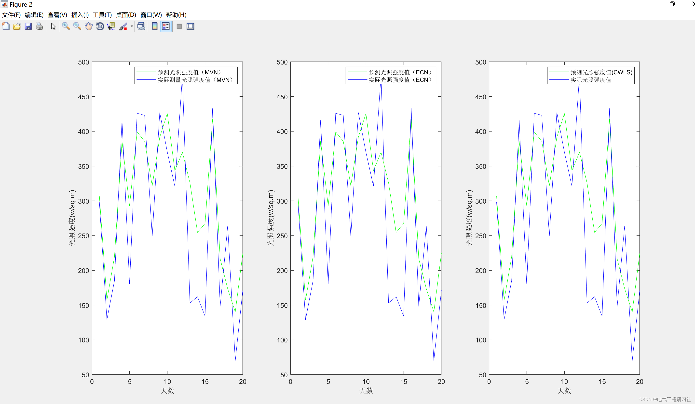
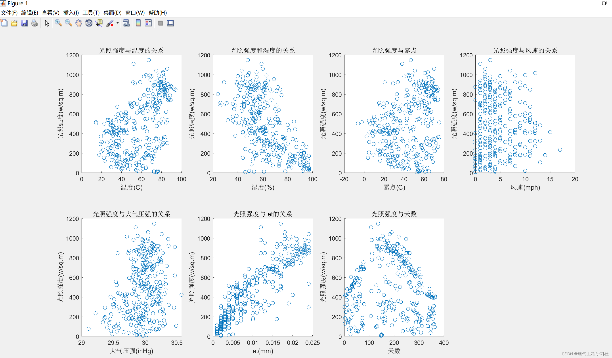
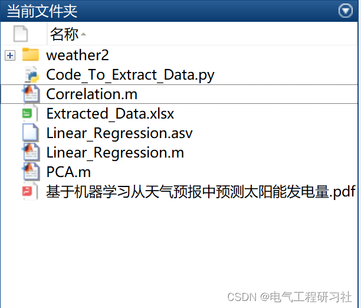

# Predict solar power generation based on weather forecasting using least squares and SVM (Matlab code implementation)

​  
1. Overview
A key objective of the smart grid plan is to significantly increase the proportion of renewable energy in the grid's energy mix. One challenge in integrating renewable energy into the grid is that their generation is intermittent and uncontrollable. Therefore, forecasting future renewable energy generation is crucial, as the grid must schedule generators to meet demand as generation changes. While developing complex forecast models manually for large solar power plants may be feasible, it presents a challenging problem to apply this development across millions of households with distributed generation in the entire grid. To address this issue, in this paper, we explore the use of machine learning techniques to automatically create site-specific solar power generation forecast models from National Weather Service (NWS) weather forecasts.We compared multivariate regression techniques used to generate predictive models, including linear least squares and support vector machine with multiple kernel functions. We evaluated the accuracy of each model using historical NWS forecasts and sun intensity readings from meteorological stations deployed for nearly a year. Our results indicate that the SVM-based predictive model built with seven different weather forecast indicators is 27% more accurate than existing predictive models.
2 Outlook To facilitate better planning and reduce barriers to increasing the proportion of renewable energy in the grid, we focus on the issue of automatically generating models that accurately forecast renewable energy generation using national weather service (NWS) forecasts. Specifically, we experimented with various machine learning techniques to develop predictive models using historical NWS forecast data and associate them with solar panel power generation data. Once trained based on historical forecasts and generated data, our predictive model uses localized NWS forecasts to predict future generations across multiple time periods. Our experiments in this paper use solar intensity as a proxy for solar power generation, as it is directly proportional to solar collection [4].Importantly, since we generate models for observational power generation data from historical sites, they inherently incorporate the impact of local features on each site's power generation capabilities, such as shadows cast by surrounding trees. Since local features affect power generation, each site must adjust its prediction model in response to site-specific characteristics. We believe that automatic model generation is crucial for expanding distributed power generation across millions of households within the entire grid.
Our goal is to automate the generation of predictive models for smart homes, including on-site renewable energy sources. Both the power grid and individual smart homes can use these predictive models to plan for electricity generation and consumption in advance. The power grid can use these models to plan generator scheduling more effectively as the proportion of renewable energy within the grid increases. Smart homes can use these models to potentially plan their consumption patterns to better match the electricity they produce on-site. In both cases, a better predictive model is a prerequisite for enhancing efficiency and encouraging broader adoption of distributed renewable energy generation in both the power grid and smart homes.
3. Editing Matlab runtime results
Editor
4. Matlab code + data + detailed explanation of the article. This article only showcases a part of the code, all codes can be found in:
Editor
figure(2)\nsubplot(1,3,1);\nplot(day_data(1:20),expected_value_validation_mvn(1:20),'g',day_data(1:20),solar_data(1:20),'b')\nlegend('Predict light intensity value (MVN)','Actual measurement of light intensity value (MVN)')\nxlabel('Days')\nylabel('Light intensity(w/sq.m)')\n\nsubplot(1,3,2);\nplot(day_data(1:20),expected_value_validation_ecm(1:20),'g',day_data(1:20),solar_data(1:20),'b')\nlegend('Predict light intensity value (ECN)','Actual illumination intensity value (ECN)')\nxlabel('Days')\nylabel('Light intensity(w/sq.m)')\n\nsubplot(1,3,3);\nplot(day_data(1:20),expected_value_validation_cwls(1:20),'g',day_data(1:20),solar_data(1:20),'b')\nlegend('Predict light intensity value(CWLS)','Actual illumination intensity value')\nxlabel('Days')\nylabel('Light intensity(w/sq.m)')\n  
​  

## Images

<!-- PAYMENT_BLOCK -->

## Get this dataset

- Payment link (Stripe): [Buy now](https://buy.stripe.com/3cs8yP7sY87d0vu9AB)
- Payment QR code: 

<!-- /PAYMENT_BLOCK -->
